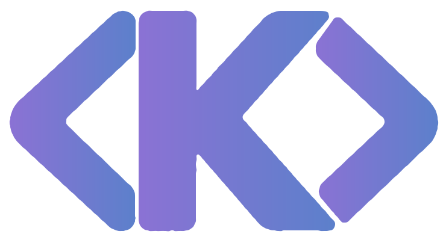

<div align="center">

<picture>
  <source media="(prefers-color-scheme: dark)" srcset="./assets/logo-clean-dark.svg">
  <source media="(prefers-color-scheme: light)" srcset="./assets/logo-clean-light.svg">
  
</picture>

# Kauan | Código Prático

### E se der certo? Eu prefiro descobrir construindo.

Portfólio pessoal de desenvolvimento fullstack, projetos web e mobile e criação de produtos.

[](https://kauan-codigo-pratico.pages.dev/)
[](https://www.linkedin.com/in/codigo-pratico/)
[](https://github.com/codigopratico)

</div>

---

## Sobre

Um espaço para apresentar quem sou, os projetos que construo e as tecnologias que utilizo. A identidade visual conecta roxo e azul, elementos inspirados em blueprint e o conceito **“Ideias virando produtos”**.

Sou formado em Informática para Internet pelo IFPE e curso Bacharelado em Inteligência Artificial no CIn-UFPE. Minha atuação reúne desenvolvimento fullstack, interesse por negócios e construção de produtos digitais.

## Funcionalidades

- Layout responsivo e menu mobile.
- Temas claro e escuro, com preferência salva no navegador.
- Navegação por seções e indicação da seção ativa.
- Animações suaves ao rolar para cima e para baixo.
- Respeito à preferência de movimento reduzido.
- Catálogo de projetos e estudos de caso.
- Capturas reais das aplicações.
- Logo e favicon em SVG com fundo transparente.
- Contato por WhatsApp com mensagem pronta, e-mail e redes sociais.

## Projetos

| Projeto | Sobre | Acesso |
| --- | --- | --- |
| **MarcaAi** | SaaS de agendamento online e gestão de horários. | [Aplicação](https://marcaai.online/) |
| **TRACE — Follow the Evidence** | Exploração de evidências climáticas históricas de Recife. Desenvolvido pela equipe Marco Zero no NASA Space Apps Challenge 2026. | [Aplicação](https://victor-tenorio.github.io/trace-follow-the-evidence/) · [Código](https://github.com/victor-tenorio/trace-follow-the-evidence) |
| **Exceptios** | Aplicação web e mobile em desenvolvimento para a relação entre advogados e clientes. | Em desenvolvimento |

No TRACE, minha contribuição se concentrou na interface, navegação, visualização de dados, responsividade e integração com a API.

## Tecnologias do portfólio

**HTML · CSS · JavaScript**

Site estático, sem instalação de dependências ou etapa de build. As tecnologias utilizadas nos projetos apresentados são descritas no próprio site.

## Executar localmente

Clone o repositório:

```bash
git clone https://github.com/codigopratico/portfolio.git
cd portfolio
```

Abra o arquivo `index.html` no navegador.

Opcionalmente, com Python instalado:

```bash
python -m http.server 8000
```

Acesse `http://localhost:8000`.

## Estrutura

| Arquivo ou pasta | Função |
| --- | --- |
| `index.html` | Estrutura principal e metadados |
| `styles.css` | Layout, temas e animações |
| `app.js` | Conteúdo, navegação e interações |
| `assets/` | Capturas dos projetos, fotografia, logos e favicon SVG |
| `favicon.png` e `favicon.ico` | Versões raster do favicon |

## Publicação

Hospedado no **Cloudflare Pages**, com integração ao GitHub. Atualizações enviadas à branch `main` disparam uma nova publicação.

| Configuração | Valor |
| --- | --- |
| Framework | None |
| Build command | `exit 0` |
| Output directory | `.` |
| Production branch | `main` |

**Site:** https://kauan-codigo-pratico.pages.dev/

## Contato

[LinkedIn](https://www.linkedin.com/in/codigo-pratico/) · [Instagram](https://www.instagram.com/codigo_pratico/) · [E-mail](mailto:fandaart.75@gmail.com)

---

<div align="center">
  <sub>Curiosidade em movimento. Ideias virando produtos.</sub>
</div>

